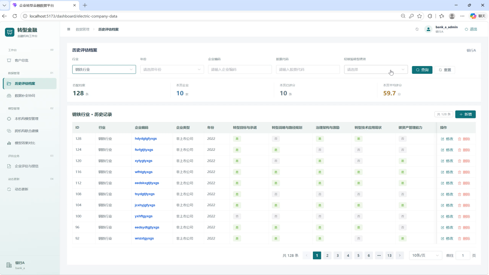

# 企业转型金融数据评估平台

面向金融机构与企业的转型金融数据管理、可信核验和动态评价系统。项目覆盖基础化工、建材、有色金属、煤炭、电力、石油石化、航空机场和钢铁八个行业，将通用指标与行业专项指标用于模型训练、评分及转型进展跟踪。

## 项目演示

[](https://github.com/zisangwucuo/Tran_Finance/blob/main/docs/demo/tran-finance-demo.mp4)

**[查看演示视频](https://github.com/zisangwucuo/Tran_Finance/blob/main/docs/demo/tran-finance-demo.mp4)** · **[下载 MP4 原视频](https://github.com/zisangwucuo/Tran_Finance/raw/refs/heads/main/docs/demo/tran-finance-demo.mp4)**

录制日期：2026-11-19。视频时长 2 分 16 秒，分辨率 2560 × 1440，完整原文件约 60 MB。若 GitHub 页面未显示播放器，可通过下载入口在本地观看。

## 主要功能

- **金融机构工作台**：客户概览、历史与待评估企业数据、缺失数据通知、评估报告。
- **企业工作台**：企业注册登录、数据查询、补充材料和材料提取结果审核。
- **行业模型训练**：按机构、行业训练随机森林，配置超参数，查看评估指标和特征重要性。
- **联邦协同评价**：按机构样本数加权集成同行业本地模型，提供协同评分。
- **共同客户核验**：通过独立 PSI 节点执行隐私求交，对共同企业年度记录核对指标一致性。
- **动态更新与模型对比**：跟踪评价变化，比较统一样本和时间划分下的模型表现。
- **材料与报告**：PDF 文字提取、Windows OCR、候选指标核验与采纳；可选接入 AI 材料提取和报告解读。

## 技术栈

| 模块 | 技术与依赖管理 |
| --- | --- |
| 前端 | Vue 3、Vite 5、Element Plus、ECharts、npm |
| 后端 | Java 17、Spring Boot 3.3、MyBatis-Plus、Maven |
| 数据库 | MySQL 8 |
| 模型服务 | Python、FastAPI、pandas、scikit-learn、pip |
| 隐私求交 | Python 节点服务、MPC4J Java 引擎、Maven |

## 目录

```text
backend/                     Spring Boot REST API
frontend/                    Vue 页面与可视化
ml-service/                  模型训练、预测与模型对比
psi-service/                 隐私求交节点与 Java 引擎
database/                    分阶段数据库脚本与数据处理记录
scripts/                     启动、构建、核验与数据工具
docs/                        功能说明与演示视频
TransformationalFinance.sql  数据库初始化脚本
```

## 本地运行

以下命令以 Windows PowerShell 为例。准备 JDK 17、Maven 3.9、Node.js 20 或 22、Python 3.11、MySQL 8。全新数据库先执行根目录的 `TransformationalFinance.sql`；该脚本会初始化部分业务表与演示数据，不要把它当作已有数据库的日常升级脚本。

### 1. 获取源码

```powershell
git clone https://github.com/zisangwucuo/Tran_Finance.git
cd Tran_Finance
```

### 2. 配置数据库

在启动后端和模型服务的终端中分别设置：

```powershell
$env:DB_HOST = "127.0.0.1"
$env:DB_PORT = "3306"
$env:DB_NAME = "trans_finance"
$env:DB_USERNAME = "root"
$dbCredential = Get-Credential -UserName $env:DB_USERNAME -Message "请输入本机 MySQL 凭据"
$env:DB_PASSWORD = $dbCredential.GetNetworkCredential().Password
```

本地配置可使用 `backend/src/main/resources/application-local.yml` 和 `ml-service/.env.local`，它们不随仓库发布。数据库密码、API Key 和节点凭据由各自运行环境提供。

### 3. 启动模型服务

在项目根目录运行：

```powershell
python -m venv ml-service/.venv
.\ml-service\.venv\Scripts\python.exe -m pip install -r ml-service/requirements.txt
.\ml-service\.venv\Scripts\python.exe -m uvicorn app:app --app-dir ml-service --host 127.0.0.1 --port 8090
```

### 4. 启动后端

在已配置数据库环境变量的新终端中运行：

```powershell
cd backend
mvn spring-boot:run
```

后端地址：`http://localhost:8080`。

### 5. 启动前端

在项目根目录的新终端中运行：

```powershell
cd frontend
npm ci
npm run dev
```

访问 `http://localhost:5173`，金融机构入口为 `/login`，企业入口为 `/company/login`。首次使用请通过注册入口创建账号。

### 6. 可选服务

- **PSI 共同客户核验**：安装 `psi-service/requirements.txt` 中的依赖，按 [PSI 服务说明](psi-service/readme.txt) 准备三家机构，再运行 `start-psi.bat`。节点使用 `8111`、`8112`、`8113` 端口。当前为单机多节点演示，部署边界见该模块说明。
- **AI 解读**：默认关闭。需要时设置 `SPRING_PROFILES_ACTIVE=doubao`、`AI_NARRATIVE_ENABLED=true`、`ARK_MODEL`、`ARK_API_KEY`。配置示例采用环境变量引用，不内置密钥。
- **企业账号初始化**：如使用批量初始化工具，通过运行环境提供 `COMPANY_DEFAULT_PASSWORD`；不设置通用默认密码。

## 构建与测试

前端生产构建：

```powershell
cd frontend
npm run build
```

后端测试与打包，在项目根目录执行：

```powershell
mvn -f backend/pom.xml test
mvn -f backend/pom.xml package
```

后端打包会包含已构建的 `frontend/dist`。生成 JAR 后可运行根目录 `run.bat`，按提示填写本机配置。该启动器会释放 `8080` 端口，请在运行前确认端口用途。

模型服务测试：

```powershell
cd ml-service
.\.venv\Scripts\python.exe -m unittest test_training_parameters test_comparison
```

数据库、真实 PSI 节点、真实 PDF/OCR 和在线 AI 的集成测试需要相应本地环境，默认测试会跳过未启用的集成场景。

## 更多说明

- [项目启动说明](启动说明.md)
- [模型服务说明](ml-service/README.md)
- [模型对比实验](docs/模型对比实验.md)
- [材料提取演示说明](docs/材料提取演示说明.md)
- [材料提取 OCR 更新说明](docs/材料提取OCR更新说明.md)
- [PSI 服务及第三方许可证](psi-service/readme.txt)
